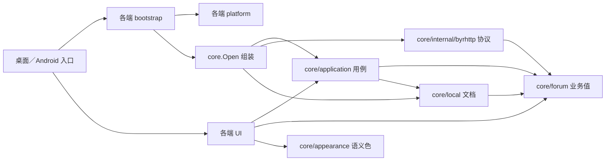

# BYR Client Go 接口与包组织优化设计

`2484f85` 之后的边界和迁移路线见 [0.6.3 API 与界面解耦](#063-api-与界面解耦)。主题读取合同已经落地，本文的协议路径表可用于行为对照。

基线为 `cc7fe4d`（0.6.3）。建议沿用现有分层与手动构造注入，先把主题读取、全站搜索、消息和草稿的业务规则集中到共享应用层，再按调用边界整理文件。桌面和 Android 各自控制页面、返回栈、渲染和系统交互。两端继续直接编译共享 Go 核心。

## 代码审查与参考

主要参考是 Go 改写前的 Flutter 源码 `5328eba`。原版 `lib/app/bootstrap.dart` 和 `lib/app/app_services.dart` 提供单点组装，`lib/shared/data/byr_api.dart` 管理多个论坛 API，`lib/shared/data/api/` 按业务区分端点，`lib/shared/storage/` 管理会话、历史和草稿。用 `git show 5328eba:lib/shared/data/byr_api.dart` 可核对。4.0.0 APK 的本地分析记录进一步按 `features`、`remote/service` 和 `local` 归类，参见 `ref/report/app/architecture.md`、`ref/report/api/`。HTTP 细节以下面链接的现行 Go 合约测试为准。

| 优先级 | 当前代码 | 影响与建议 |
| --- | --- | --- |
| P0 | `application.App` 公开 `Forum`、`Local`，两端主题加载分别处理收藏状态和阅读历史。Android 启动在 UI 内找目录、读状态、建凭据和恢复会话，桌面已有 `bootstrap.New`。 | 同一流程在两端的取消、错误与账号采样时点不同。先合并主题用例与会话边界，再将 Android 的组装移至 `internal/bootstrap`。 [应用入口](../core/application/app.go) · [桌面主题](../apps/desktop/internal/desktop/thread.go) · [Android 主题](../apps/android/app/internal/ui/pages.go) |
| P0 | 两端的 `run` 用一个 `busy` 协调导航、读请求和提交。桌面有序号检查，Android 有 128 项更新通道及逐路由检查。全局忙碌还会阻塞返回和辅助查询。 | 路由读取与资源请求独立取消，写操作按目标锁定。统一检查结果所属账号、路由及请求代际。 [桌面 run](../apps/desktop/internal/desktop/app.go) · [Android run](../apps/android/app/internal/ui/app.go) |
| P0 | `SaveDraft` 可在两个 UI 的输入、返回或关闭路径里写盘。`local.Store.change` 持有读写锁直至完成 JSON 往返复制和持久化。 | UI 输入会直接等待文件写入，其他读取也可能等待写者。改为草稿快照后台保存，分离本地状态的写序列与读快照。 [桌面编辑器](../apps/desktop/internal/desktop/compose.go) · [Android 编辑器](../apps/android/app/internal/ui/compose.go) · [本地存储](../core/local/store.go) |
| P1 | 全站搜索每次枚举分区树，6 个 worker 查询版面。合并前仍保留各版结果，页码可被服务端估计总量引导至 100 条窗口以外。首个普通错误可能遮住随后触发取消的认证错误。 | 将结果窗口、部分结果、认证失败和翻页能力显式建模。先修正页码与错误契约，再压低网络与内存成本。 [搜索用例](../core/application/search.go) |
| P1 | 会话加载先取两个信箱的首页，每箱最多 100 条，再串行请求匹配邮件正文。Android 解码图片的后台任务按新 URL 启动，图片表无容量上限。桌面图片缓存超过 160 项后整表清空。 | 聊天先建立受限页面快照，再按可见范围有界地拉取正文。媒体采用队列、缓存预算和稳定占位。 [消息用例](../core/application/messages.go) · [Android 图片任务](../apps/android/app/internal/ui/images.go) · [桌面图片任务](../apps/desktop/internal/desktop/images.go) |
| P1 | 投票／竞猜预检查在桌面加载主题后执行，Android 在打开更多菜单时执行。桌面要求响应 `aid` 匹配，Android 接受空 `aid`。 | 共享判定并用夹具确定缺失字段的语义。预检查独立于正文加载，按需要触发。 [桌面预检查](../apps/desktop/internal/desktop/thread.go) · [Android 预检查](../apps/android/app/internal/ui/thread_actions.go) |

审查范围内没有发现生产 `init()` 启动副作用。Android 的可变包级调色板是应拆除的共享 UI 状态，包级已编译正则和不可变资源继续复用。协议默认客户端已有 30 秒超时，注入的客户端配置和跨多个请求的用例仍需单独校核。

## 模块、包和依赖方向

```text
桌面 main / Android main
  └── 各自 internal/bootstrap ── 组装 application、local.Backend 与平台凭据
      └── 桌面 desktop / Android ui ── 页面动作和数据模型
          └── application
              ├── forum ── HTTP、鉴权、JSON 和协议模型
              └── local ── 状态文档、草稿、阅读历史与偏好
UI 正文和编辑 ── core/content 与 core/resources
OS 能力 ── 各端 internal/platform
```

| 位置 | 目标组织 |
| --- | --- |
| `core/application/` | `app.go` 放依赖与构造。按 `session.go`、`multi_account.go`、`browse.go`、`thread.go`、`publish.go`、`interactions.go`、`search.go`、`messages.go`、`preferences.go`、`media.go` 分组。会话、权限、响应整形和跨请求规则由应用用例承担。 |
| `core/forum/` | 先把 `endpoints.go` 按文章、版面／分区、收藏、搜索、消息、用户、投票／竞猜和版本分文件，包名和公开签名沿用。保留单一 `Client`、共用的请求、认证、JSON、媒体和错误代码。 |
| `core/local/` | `store.go` 持有状态文档和事务。可提取 `draft.go`、`history.go`、`preferences.go`，它们共享同一存储实例。 |
| `core/content/`、`core/resources/` | UBB、附件标记、Unicode 编辑和嵌入字库可由两端调用。正文解析可继续用 `forum.Attachment`，框架字面、主题和图片呈现属于 UI。 |
| `apps/desktop/internal/desktop/`、`apps/android/app/internal/ui/` | 先在各自包内拆壳层、导航、任务、主题、编辑器和具体功能文件。重点拆出 Android `app.go` 与 `pages.go` 的启动、布局和用例结果应用。具有独立状态和可测试接口的组件可在后续提取到各端 `internal/`。 |
| 两端 `internal/bootstrap/`、`internal/platform/` | 桌面延用现有组装方案。Android 新增组装入口，注入数据路径、`local.Backend`、凭据、`BaseURL` 与可选 HTTP client。UI 只处理启动、恢复和失败状态。文件、凭据、剪贴板、保存图片及系统偏好由各端适配。 |

根 `go.work` 继续聚合 `core`、`apps/desktop`、`tools`。Android 生产模块和技术探针维持独立 `GOWORK=off` 和相对 `replace`。跨模块调用的 `core/application`、`core/forum`、`core/local`、`core/content` 与资源包保留在 `core` 的可导入路径。各应用私有实现放在自己的 `internal` 内。现有发布工具从桌面 `mygo.json` 的 `main: "."` 和 Android `gogio ... .` 打包，本轮采用各模块根的薄 `main.go`。目录调整优先减少依赖和调用跨度，保持现有模块地址及开发命令可用。 [仓库工作区](../go.work) · [Go 模块布局](https://go.dev/doc/modules/layout)

构造函数延用 `Options` / `Config` 传必需依赖，并在构造时校验。桌面的 `Window.Update`、Android 的事件循环、两端对话框均由本端组装。测试通过 `httptest`、现有 `local.Backend` 与 `CredentialStore` 替身注入。UI 通过具体 `*application.App` 发起业务调用，可继续使用 `forum` 的响应值类型。测试或可替换边界确实需要时，由消费方定义小接口，例如仅负责保存图片的系统适配。保留一个共享 `forum.Client` 与统一协议路径，按功能组织应用方法。只迁移 UI 确实使用的入口，其中单次读取可简短转发，附带多端规则的放入对应功能文件。

## 接口合同与迁移映射

下表路径以当前行为为依据，花括号内是资源参数。迁移的是调用和约束的位置。

| 功能 | 当前协议 | 应用层和 UI 的调用合同 |
| --- | --- | --- |
| 登录、恢复、账号 | `POST /oauth2/official`，网页诊断 `POST /user/ajax_login.json`，本地凭据适配器 | 延用 `Login`、`Restore`、`Logout`、`SavedAccounts`、`SwitchAccount`、`ForgetAccount`。增加非敏感会话视图给 UI。诊断单独调用，保留 OAuth 会话。 |
| 分区、版面 | `GET /open/section.json`、`/open/section/{name}.json`、`/open/board/{name}.json` | `Sections`、`BrowseSection`、`ReadBoard` 提供界面所需数据。共享分区引用补全、去环和缺项处理。子分区描述的补全失败保留可用名称或 ID。置顶折叠、分栏和树展开由 UI 保存。 |
| 主题、楼层、附加功能 | `GET /open/threads/{board}/{id}.json`、`/open/article/{board}/{id}.json`、`/open/vote/{id}.json`、`/open/bet/{id}.json` | `ReadThread` 统一版面身份、分页、收藏合并和主楼识别，加载投票／竞猜使用独立的 `ThreadExtras`。UI 按楼层 ID 定位，展示返回条件相符的入口。 |
| 新帖、回复、编辑、删除与附件 | `POST` 文章 `/open/article/{board}/post.json`、`/open/article/{board}/update/{id}.json`、`/open/article/{board}/delete/{id}.json`。附件 `POST /open/attachment/{board}/add/{id}.json`、`POST /open/attachment/{board}/delete/{id}.json`。 | 保留 `Publish`、`ValidatePost` 和独立的 `Publication.LocalError`。删除和附件写入在明确目标下执行一次。新帖省略 `reid`，回复使用实际目标，上传保留空文章 ID 对应的 `add/.json` 及 multipart `file` 字段。 |
| 评价与收藏 | `GET /open/article/{board}/like/{id}.json`、`GET /open/article/{board}/votedown/{id}.json`。收藏读 `GET /open/favorite/0.json`、`GET /open/collection.json`，写入为各自的 `add`、`delete` POST。 | 沿用 `React`、`SetCollected`。评价按写操作管理，固定版面收藏目录 `0`。合并匿名帖兼容响应、重复状态和收藏确认，UI 根据共享用例回传状态更新计数和选中态。 |
| 时间线、十大、推荐 | `GET /open/favorpost.json`、`/open/widget/topten.json`、`/open/widget/recommend.json` | 保持独立查询能力，应用层只共享必要的分页和文章标识规则。 |
| 全站标题、版面及用户搜索 | `GET /open/search/article.json`、`/open/search/board.json`、`/open/user/query/{id}.json` | `Search(SearchRequest)` 继续承担标题搜索和按版面查询。版面搜索和用户精确资料查询独立。AI 未配置保持 UI 状态。 |
| 联系人、信箱、提醒 | `GET /open/mail/{box}.json`、`GET /open/mail/{box}/{index}.json`。写操作 `POST /open/mail/send.json`、`POST /open/mail/{box}/{action}/{index}.json`，提醒通过 `/open/refer/{kind}` 合约处理。 | 联系人和聊天聚合归 `application`。回复信件走回复接口，转发、删除、已读用显式目标。站内信 ID 始终带信箱，提醒跳转保留版面、主题和目标楼层。 |
| 偏好、历史、媒体 | `state.json`、凭据存储、`forum.FetchAsset` | UI 读取偏好快照并提交更新。历史和草稿按账号操作。媒体从共享安全入口读取原始资源，各端负责解码、保存对话框与展示。 |

合同样例见 [协议端点测试](../core/forum/endpoints_test.go)、[线上响应形状夹具](../core/forum/server_shapes_test.go)和 [会话及发布测试](../core/application/app_test.go)。保留 `Scalar`、`Flag`、`Number`、对象与数组兼容和 `DecodeError`。URL 编码、认证、IPv6 镜像、路径、表单和分页仍由 `forum` 管理。

### 首个切片采用主题读取

下面是建议的签名。复用 `forum.Page`、`forum.Thread`，用小类型收敛成功返回后的额外信息。

```go
type SessionInfo struct {
    Username      string
    Authenticated bool
    Generation    uint64
}

type ThreadDetail struct {
    Thread         forum.Thread
    CanonicalBoard string
}

func (a *App) SessionInfo() SessionInfo
func (a *App) ReadThread(ctx context.Context, board, id string, page forum.Page) (ThreadDetail, error)
func (a *App) RecordThreadVisit(ctx context.Context, generation uint64, board, id, title string) error
```

1. `ReadThread` 获取主题并合并当前账号的收藏状态。规范版面依次使用响应 `Thread.Board`、首个有版面名的楼层和请求版面。区分主题 ID、楼层 ID 和 `group_id`。编辑主题前按 ID 确认主楼，必要时调用文章详情。后续页首行可以是普通回复。
2. UI 在主线程核对账号代际、路由和请求序号，应用正文后提交一次异步阅读记录。记录目标带载入时的代际，过期任务取消。保存历史失败只提示本地问题，保留已加载正文。定位目标楼层及滚动锚点由各端列表状态处理。
3. `ThreadExtras` 按账号、版面和主题键独立加载。确认返回的 `aid` 指向当前主题后显示对应入口。针对空 `aid` 用固定响应样本核对。在证据明确前沿用现有端侧兼容分支，拉取失败在附加操作区域处理。
4. 两端切换到共享方法后，继续迁移已确定归属的写入口和本地存储。全部消费路径收敛后，将 `App.Forum`、`App.Local` 改为私有字段，移除桌面组装返回值中多余的 `Forum` 字段。协议包本身仍可单独做合同测试。

### 全站搜索

- 当前官方搜索的兼容方案是查询各版面。单版保持服务端分页，全站结果以最多 100 条的合并窗口为初版上限。先按 `size` 检查可达页数，再计算 `page*size`，覆盖极大页码和最后一个不足一页的窗口。可返回的实际页数驱动下一页按钮，服务端估算量单列。建议保留 `Truncated` 的广义覆盖提示，并增加 `Incomplete` 表示版面失败或超时造成的部分结果。只有查询覆盖完整且没有匹配项时才显示「无结果」。
- 建立短期的版面目录缓存，键包含站点、镜像和账号代际。显式刷新、账号切换和镜像变更淘汰关联缓存。首先维持现有 6 并发，结果从有界通道流入单一合并器，保留窗口所需候选并按规范版面和主题标识去重，以发帖时间及稳定标识排序。按真实搜索规模调节缓存寿命和请求总预算。
- 认证失败单独记录并取消其他 worker，最后优先返回认证失败。普通版面失败可返回已取得的结果及范围说明。单板查询仍保留完整合同，旧 `SearchRequest` 和默认页大小的调用方继续可用。用请求计数、取消、重复主题、全部失败和并发不同顺序的夹具验收。 [现有搜索测试](../core/application/search_test.go)

### 消息、媒体与超时

- 联系人先保留当前两个信箱首页窗口，并显式处理单箱失败。聊天先返回按时间排序的条目，完整正文按信箱和索引通过限并发的队列读取，首屏附近优先。详情失败占据原条目并提供单项重试。自发自收继续采用 outbox 副本，保持作者方向、正文和顺序。兼容迁移阶段保留当前 `Conversation` 调用，待两个 UI 能消费部分详情再切换。
- 现有 `forum.Client` 继续复用 HTTP transport。区分单请求与用例总期限，初始建议普通读每次 10 秒、全站或消息聚合总计 20 秒、原图或上传 60 秒，再以目标网络采样校准。启用 60 秒媒体期限前核对现有客户端 30 秒的总超时，设置期限时尊重调用方更短的截止时间。只读请求可通过显式重试恢复，写操作按业务语义分类，包含使用 GET 的评价和可能标记已读的信件读取。状态写入只从明确的用户提交入口发起。
- 保留 JSON 8 MiB 与现有媒体／上传 32 MiB 上限，以及 `FetchAsset` 的源站认证、重定向限制和 URL 脱敏。先用有界队列和缓存控制总量。建议起点为 Android 3 个工作项、48 MiB 常驻图片缓存，桌面 6 个工作项、128 MiB。压缩字节和解码占用共同计量。窗口关闭及账号切换取消关联任务，播放器在淘汰时关闭。原图使用单独的临时预算，限制解码尺寸与 GIF 可用帧数，无法提前验证整段动画预算时采用首帧。
- 若上传缓冲被证实是主要内存成本，再在协议层评估限量临时文件或流式 multipart。先用本地服务验证超限、取消、临时资源回收、`Content-Length` 兼容及空 ID 路径。原子落盘仍由平台文件适配器承担。

## 生命周期与持久化

### 请求与会话

| 任务类型 | 归属与提交条件 |
| --- | --- |
| 路由读取 | 任务向下传递 `context`，页面只存取消函数、请求序号、最后成功值和错误。更换目标时取消上一读请求。结果同时匹配账号代际、路由键与序号后提交。刷新期间保留已有值，新路由呈现自己的加载态。 |
| 图片、附加功能、会话详情 | 与对应账号和资源键绑定，使用有界并发。离开页面时只保留预算内可复用资源。Android 由更新队列批量提交结果，每帧处理有限工作，剩余项再请求下一帧。 |
| 发布、回帖、发信、删除、评价 | 针对同一目标合并互斥操作的执行状态，赞和踩共用一个并发键。页面仅禁用受影响的操作。服务端确认后记录成功，超时等无法确认的状态引导查验。页面回调失效时仍可恢复已提交结果。 |
| 登录、退出、切换和移除活动账号 | 在应用层串行变更凭据与当前会话。持久化成功后再提升会话代际。旧账号请求完成后只允许应用到其原代际，切换后清理 UI 的路由、媒体、页码、搜索和草稿视图。 |

需要认证的论坛用例在入口绑定账号、代际和请求凭据快照，整条多步操作用同一身份。可以让 `forum.TokenSource` 读取应用层在私有上下文中绑定的凭据，复用同一 transport。UI 只获取 `SessionInfo`。切换账号时，先处理旧编辑器的待保存快照，再取消旧读任务。关键写操作要等确认或进入可查询的状态后才切换，以免写请求用新账号继续执行。关窗或销毁先取消读和资源任务，按有上限的本地保存流程收尾。

### 草稿与状态文档

1. 保留 `state.json` v1、账号键规范化、已有 `DraftKey`、最近 100 条阅读历史、主题和字号值。多账号凭据延用桌面系统凭据存储和 Android 私有目录，保留旧版凭据迁移测试。
2. 编辑时在 UI 线程捕获不可变快照，按账号、草稿键与修订号后台合并，初始防抖 300ms。返回页面、换账号、关闭和发布之前通过明确的异步保存确认流程处理最后一版。保留实际保存错误和原输入，连续编辑时旧版本回执只更新对应版本的状态。
3. 发布开始前确认该修订号已保存，冻结新的编辑写入。服务端确认后废止所有更旧的待保存快照，再删除当前草稿键与适用的无版面新帖草稿键。可在 `local.Store` 增加同一事务内删除多个键的操作。磁盘清理失败返回 `LocalError` 和已发布文章信息，界面保持发布完成。服务端结果未确认时保留草稿并查询结果。
4. 将写事务与读取快照分离。写锁串行化构造副本、校验、持久化和发布，读锁只保护读取或切换已经持久化的快照。修改涉及账号、草稿和附件时对对应数据做深拷贝。锁等待后重新核对上下文取消，在持久化成功后提交该快照。

## 实施顺序与回归

1. **建立对照。** 保留现有模块检查和夹具，更新 opt-in 桌面截图中失效的按钮定位。记录两端请求序列、登录／返回行为、行位置和编辑器落盘顺序。普通离线检查作为每次提交的基线。
2. **主题与任务切片。** 增加 `ReadThread`、异步阅读记录、非敏感会话视图与 Android `bootstrap`。在桌面和 Android 分别切换一次真实页面入口，然后拆出路由读、附加读取和写操作的生命周期。
3. **草稿、搜索和消息。** 先完成发布与后台合并的互斥及磁盘失败测试，再做搜索有界合并和可翻页合同。消息以真实正文、自己给自己发信和已读顺序为回归重点。
4. **边界收口。** 将剩余 UI 直接调用按功能迁移，把核心成员私有化，在原包内移动端点和 UI 文件。每个移动批次保持现有打包入口。与 [UI 设计](ui-redesign.md) 的宽屏、滚动和媒体切片在主题页汇合。

| 验收 | 可执行检查 |
| --- | --- |
| 模块与入口 | 根目录 `go run ./tools/dev check`，覆盖 core、tools、desktop、Android 的 test/vet。核心隔离试验用 `go run ./tools/dev check android-core`，Gio 探针用 `go run ./tools/dev check --scope gio-probe`。核心保持 [架构测试](../core/architecture_test.go) 通过。 |
| 并发正确性 | 在 `core` 中以 `GOWORK=off` 运行 `go test -race ./...`。用通道控制 A、B 读请求逆序完成、账号切换后的旧结果、关窗时的在途请求，以及发布前后交错保存。覆盖落盘失败和原草稿键重启恢复。 |
| 协议正确性 | 用现有 `httptest` 合同检查 OAuth、分页、空上传 ID、匿名评价、固定收藏目录、信件回复、错误分类和资源重定向。新增夹具应验证对应迁移引入的行为。 |
| 界面契约 | 延用桌面返回位置、Android 返回与 IME、文章收藏、目标楼层和草稿测试。若将「繁忙时禁止一切导航」改成「只锁写目标」，更新专项行为用例以覆盖读取时返回和过期丢弃。 |

本次已通过四个主模块及 Gio 探针的 test/vet、核心 race 测试和 `android/arm64` 核心交叉编译。Android 尺寸、真实输入法、滚动和系统返回验收见 [UI 设计的验证边界](ui-redesign.md#实施与验收)。现有 `docs/architecture.md` 中 Android 待选型的段落早于 Gio 生产模块，以当前 Go 源码、构建配置和本设计的基线说明核对。

## 0.6.3 API 与界面解耦

推荐沿用**共享应用层、协议与存储适配器、各端独立界面**，通过显式构造注入组装。现有搜索、主题读取和发布方法已提供这个方向的基础。先收口真实的调用路径，再移动包。每一批都能单独回归和构建。

### 当前边界与调整理由

在 `core`、桌面、Android 生产模块、`tools` 和 Gio 探针的目录中分别设置 `GOWORK=off`，用 `go list -mod=readonly ./...` 盘点包与直接导入。核心保持标准库依赖，MyGo 和 Gio 已处于不同模块。可利用现有边界继续收敛应用内部的依赖。

| 优先级 | 源码证据 | 影响与调整 |
| --- | --- | --- |
| P1 | `application.App` 公开 `Forum`、`Local`，`Session()` 还能返回含 token 的凭据。`ReadThread` 和 `RecordThreadVisit` 已共享会话代际、版面规范和历史合同。 | 将私信、分区版面、偏好、历史、媒体逐个迁到 `App` 用例。多个端点组成的用例绑定同一会话，UI 通过 `SessionInfo` 获得身份，用完一组入口再收起相应底层入口。 [应用构造及凭据](../core/application/app.go#L39-L89) · [现行主题读取](../core/application/thread.go#L56-L114) |
| P1 | 双端写信页面选择 `SendMail` 或 `ReplyMail` 端点。Android 设置直接序列化 `Local.Preferences`，清空历史回调即时再读用户名。 | 独立的应用方法接受发送动作、信件标识与纯文本快照；历史清空绑定确认时的账号。页面只在收到结果后决定导航、焦点和是否保留内容。 [桌面写信](../apps/desktop/internal/desktop/mail.go#L270-L292) · [Android 写信](../apps/android/app/internal/ui/mail.go#L779-L806) · [Android 历史](../apps/android/app/internal/ui/account.go#L325-L364) |
| P1 | 桌面图片回调检查当前条目身份，Android 回调写入捕获的条目并推进 `mediaGeneration`，请求由窗口上下文启动。 | 清缓存、切号和关窗都要取消旧代资源任务。UI 按账号与媒体缓存代际调度和提交，应用层提供带会话约束的资源读取，协议层继续掌握哪些源站可以携带认证。 [桌面回调](../apps/desktop/internal/desktop/images.go#L43-L84) · [Android 回调](../apps/android/app/internal/ui/images.go#L184-L228) · [媒体协议](../core/forum/media.go#L14-L75) |
| P2 | 桌面已有 `bootstrap.New`，返回值仍暴露 `Forum`。Android 的 `ui.start` 同时准备平台目录、JSON 状态、凭据、HTTP 配置、会话与首屏。 | 将 Android 平台组装移入 `internal/bootstrap`，保留异步初始化及可恢复错误。桌面保留现有组装入口。网络默认值和地址校验放在组装或协议边界，字号、配色和镜像开关由本地偏好管理。 [桌面组装](../apps/desktop/internal/bootstrap/bootstrap.go#L12-L37) · [Android 启动](../apps/android/app/internal/ui/app.go#L443-L487) |
| P2 | `core/forum` 同时提供 HTTP 实现、线上容错 DTO 和 UI／本地文件使用的附件等数据。`core/content` 与 `core/local` 已依赖这些值。 | 先在包内按主题、信箱、搜索、分区等组织端点。待调用换完，把传输及线上格式移入核心私有包，稳定数据类型留在 `core/forum`。用历史状态文件验证附件序列化。 [请求入口](../core/forum/client.go#L141-L181) · [正文依赖](../core/content/body.go#L11-L48) · [草稿格式](../core/local/store.go#L42-L74) |
| P2 | Android `setTab` 直接重建分区栈，多个页面共用一个可变模型，当前 `restoreRoute` 需先清除再加载。 | 壳层负责来源标签、路由、页码和滚动锚点，每项读取只更新所属快照。搜索和提醒可打开同一主题，来源不同的页面位置仍独立。API 接收资源标识和分页参数。 [切换标签](../apps/android/app/internal/ui/app.go#L649-L683) · [路由恢复](../apps/android/app/internal/ui/route_state.go#L107-L174) |

### 请求路径与状态归属

以搜索页为第一条新切片。MyGo 和 Gio 把输入事件变成一次 `Search` 或 `LookupUser` 意图，在界面线程捕获关键词、模式、页码与当前会话。`application` 决定校验、数据来源、并发上限、分页与部分结果，协议适配器负责路径、编码、认证、解码及服务端错误。回调只在 UI 线程提交，匹配会话代际、路由身份和请求序号后更新相应结果。改变主题、空态排版和列表宽度只重新渲染快照。 [现行搜索合同](../core/application/search.go#L17-L80) · [现行 Android 搜索](../apps/android/app/internal/ui/search.go) · [现行桌面搜索](../apps/desktop/internal/desktop/search.go)

界面消费方在替身测试确实需要时声明小接口，下例以搜索为限。建议在同一个 `App` 上新增 `LookupUser`，继续复用现有标题搜索合同。应用层接入 HTTP 适配器时也按实际用例声明需要的读取或写入能力。各能力可由同一客户端实现和复用同一传输。

```go
// 放在需要替身的搜索界面包内。
type searchService interface {
    Search(context.Context, application.SearchRequest) (application.SearchResult, error)
    LookupUser(context.Context, string) (forum.User, error)
}
```

| 边界 | 责任和结果 |
| --- | --- |
| MyGo／Gio 页面 | 负责控件实例、输入组合态、按键、占位、可访问性、对齐、重试入口、分页跳转和锚点。每种结果有明确显示分支，包括尚未请求、第一次加载、有旧值时更新、成功空结果、部分结果、可重试失败。 |
| `core/application` | 保留 `ReadThread`、`Search`、`Publish`、`React` 等现有用例。按需求逐步加 `LookupUser`、分区／版面查询、信件发送／回复、偏好更新及账号历史管理。消费方可直接依赖具体 `App`，用例测试用窄依赖替身或现有本地 HTTP 夹具。纯文本发送、分页限制、权限、写操作互斥及已发布但清理失败的语义在此收拢。 |
| HTTP 适配器 | 单一 transport 处理 OAuth、URL、镜像、分页参数、表单、JSON 兼容、认证来源、取消及安全上限。线上 `Scalar`／`Flag`／对象或数组的容错在此转换。应用取得可判定的未认证、解码或请求失败等错误，页面据此反馈。 |
| 本地适配与平台 | `local.Store` 事务保持 `state.json` v1 的历史、草稿和偏好兼容。偏好只更新本次操作的字段，避免配色与 IPv6 设置相互覆盖。凭据、目录、磁盘、保存图片、系统栏和窗口调度由各端平台适配。网络图片解码及缓存淘汰由对应端的媒体状态负责。 |

请求开始前固定账号和会话代际，并复用 `ReadThread` 的凭据绑定方式。`Token` 对绑定的旧快照继续执行过期校验，界面处理未认证时只使用非敏感状态。会话切换后的旧结果与旧错误均丢弃。请求辅助数据和媒体可以独立取消。发送、回复、评价、删除和发布以具体操作目标互斥，用户离开后已执行的结果仍可查验，超时结果按未知状态处理。保留写请求只由明确动作发起的约定。 [Token 校验](../core/application/app.go#L71-L88) · [代际绑定](../core/application/thread.go#L48-L87)

使用已有 `ReadThread` 作回归样板。实际显示的主题页和显式刷新的目标页分开；等待和失败保留已显示正文、规范版面和锚点，成功提交第一页时再清除提醒目标并回到顶部。分区返回也先恢复页面身份，再按当前数据状态决定是否请求。历史清空串行化当前账号的历史事务，丢弃清除之前已排队但未应用的访问记录；之后新打开主题可产生新记录。媒体清理通过媒体任务代际独立处理。 [界面行为及回归清单](ui-redesign.md#063-体验修订)

### 目录结构

应用程序保留各自 `go.mod`、资源目录和打包入口。`core` 继续被两个生产模块共享。把首批重构集中在包的职责和文件名，独立子包在接口稳定且拥有独立状态后提取。

```text
core/
  open.go                    # 目标组装入口 core.Open，创建共享应用和私有适配器
  application/               # session、browse、thread、search、messages、publish、preferences、history
  forum/                     # 共享版面、主题、信件、附件等业务值与标识
  internal/byrhttp/           # HTTP 客户端及协议 DTO，按功能分文件
  local/                     # 本地文档与事务，draft、history、preferences 分文件
  content/                   # UBB、文本和选区操作
  appearance/                # 两端共用的配色 ID、语义色和默认值
  resources/                 # 字体、表情与许可
apps/desktop/
  main.go                    # 启动、创建窗口、接入生命周期
  internal/bootstrap/         # 组装核心，注入配置和平台适配器
  internal/platform/          # 数据目录、凭据、文件与系统服务
  internal/desktop/           # shell、navigation、tasks、style、各功能页
apps/android/app/
  main.go                    # 创建窗口、事件循环、insets 和生命周期
  internal/bootstrap/         # 从 UI 提出的启动组装
  internal/platform/          # 私有目录、凭据与保存图片
  internal/ui/                # app、shell、navigation、tasks、input、style、各功能页
tools/dev/                   # 现有开发和构建命令入口
tools/internal/buildflow/     # 各模块检查与打包
```



图中箭头表示包依赖。`core.Open` 仅做装配，构造一个 HTTP 客户端和本地存储，再注入应用层消费的能力。`core/internal/byrhttp` 仅供 `core` 模块树内使用，两个应用通过共享装配入口取得 `App`。`forum` 中的共享值尽量沿用已有字段和语义，只有线上形状或持久化合同确有差异时才引入转换。配色表可用标准库色值；各端实例将其转换为主题和自绘组件状态。近期 `App`、路由和页面留在同一本端 UI 包，以文件和具体状态所有者缩短导航跨度。

组装时先准备本地存储和凭据适配器，由应用层初始化会话状态。`core.Open` 可注入一个协议客户端构造函数，应用层把绑定令牌解析和 IPv6 偏好的读取回调传给它，再获得所需的用例依赖。构造过程不联网，恢复会话与首个页面请求由生命周期显式发起。应用层提供供页面判断的业务错误，协议解析失败的诊断细节沿用现有脱敏路径。

`go.work` 继续聚合 `core`、`apps/desktop` 和 `tools`。Android 生产模块、Gio 探针继续通过 `GOWORK=off` 与相对 `replace` 独立编译。MyGo 的 `main: "."`、`gogio … .`、二进制名与 APK 标识保持原有入口。将来增加独立可执行命令时使用对应模块的 `cmd/<name>`；现有入口迁移可独立评估并同步打包、CI、资源路径及运行文档。邻近的 `_test.go` 和 `testdata/` 存放应用、协议、UI 对应的夹具。 [工作区](../go.work) · [桌面入口配置](../apps/desktop/mygo.json#L7) · [Android 打包](../tools/internal/buildflow/android_production.go#L63-L70) · [构建流程](build.md)

### 迁移与验收

| 批次 | 改动和通过条件 |
| --- | --- |
| 1. 界面行为补齐 | 按 UI 文档补输入、空态、分区、缓存和外观。主题刷新、分页、点赞、提醒锚点、编辑草稿和账号迁移为回归基线。界面修复可使用现有用例独立交付。 |
| 2. 贯通搜索与启动 | 双端搜索通过 `application` 查询人物与标题，错误、部分结果和旧响应有独立测试。Android 组装移出 UI，测试可注入临时目录、HTTP 和凭据替身；首屏、过期凭据、启动失败及恢复路径通过。 |
| 3. 逐功能收口 | 私信、分区／收藏、媒体、偏好／历史按功能提交。每个提交从两个真实页面入口走同一用例，用 `httptest` 核对已支持的请求和编码。清空历史和媒体缓存验证切号、取消、持久化失败、旧回调交错。完成后将 `App.Forum`、`App.Local` 私有化，组装结果只给页面必须的服务，UI 登录判断迁到 `SessionInfo`。 |
| 4. 移动协议与拆大文件 | 先在现有包内分文件，并让 Gio 探针改用适合其离线验证目的的核心入口。全部生产调用收口后，将 HTTP 和协议测试作为一个兼容批次移到 `core/internal/byrhttp`，接到 `core.Open`。避免旧 `forum` 包向回导入该实现而形成环。附件、草稿和历史用旧 `state.json` 夹具验证。继续按职责拆 UI 壳层、导航、任务和功能文件。 |
| 5. 固化依赖与发布验证 | 扩展现有架构测试，生产 UI 依赖共享用例与业务值，请求适配器仅由核心组装引入，核心继续隔离 UI 和平台。用 `go list -deps` 检查两端独立依赖，运行 `go run ./tools/dev check`、`go run ./tools/dev check --scope gio-probe`、`go run ./tools/dev check android-core`。在可以运行 race detector 的环境复验核心切号、历史和草稿并发，再按构建文档出双端预览，按 UI 验收表走原生窗口和真机输入。 [现有架构检查](../core/architecture_test.go#L14) |

当前基线的专项离线检查已通过，包括既有的顺序输入模拟，以及桌面刷新错误状态下的末楼和分页点击、双端版面别名和部分刷新位置用例。这些结果记录当前行为，新增的原生输入、空态、分区、缓存和配色按各批次的验收重新验证。
